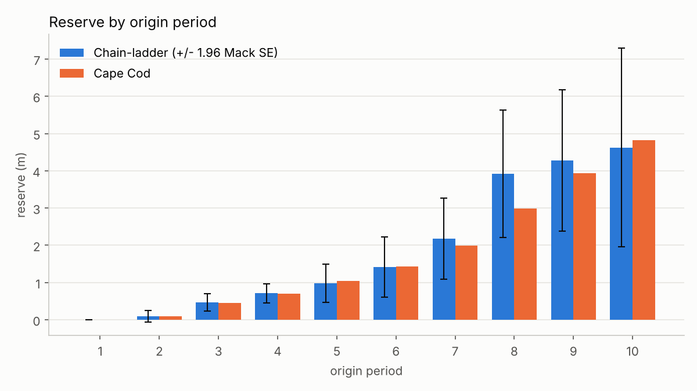
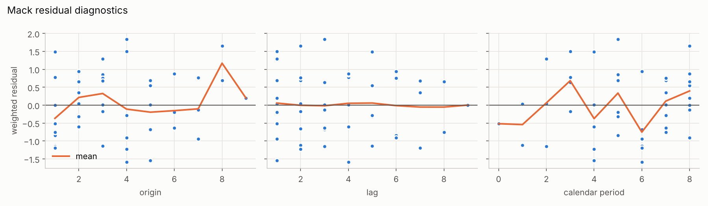

# Claims Reserving from First Principles

How much money must an insurer hold today for claims that have already happened but are not yet fully paid? This project implements the classic actuarial answers in Python **from scratch**, checks them against the published literature, and backtests them against the real later development of US insurers.

| Method | Question it answers |
|---|---|
| **Chain-ladder** | What is the best estimate of the outstanding claims? |
| **Mack (1993)** | How uncertain is that estimate? (process + parameter error) |
| **Bornhuetter-Ferguson / Cape Cod** | How do we stabilise young accident years with a prior loss ratio? |
| **Backtest on CAS Schedule P** | Do these methods actually predict well? |

## Results on the textbook triangle

The implementation reproduces Mack (1993) exactly on the Taylor & Ashe triangle:

| | This code | Mack (1993) |
|---|---:|---:|
| Total reserve | 18,680,856 | 18,680,856 |
| Total standard error | 2,447,095 | 2,447,095 |

These values are enforced by the test suite (`tests/test_published_values.py`), together with the RAA benchmark.



The youngest years carry most of the reserve **and** most of the uncertainty: the coefficient of variation for the latest origin year is about 30%, because a single observed value has to carry nine development steps. For origin year 8, chain-ladder projects an unusually high lag-3 value forward. Cape Cod gives that observation less weight and lands about 25% lower.



Weighted residuals check Mack's assumptions. A trend against **calendar period** would point to inflation or a change in claims handling, which chain-ladder cannot capture.

## Backtest on real data

The [CAS Loss Reserving Database](https://www.casact.org/publications-research/research/research-resources/loss-reserving-data-pulled-naic-schedule-p) contains Schedule P triangles of US insurers for six lines of business, **including the actual later development**. For each company the square is cut at the 1997 valuation date, reserves are estimated from the upper triangle only, and compared with what was actually paid.

No information from below the diagonal leaks into the estimate. That is why BF uses the **Cape Cod** loss ratio, estimated from the upper triangle, instead of the realised one.

```bash
python scripts/download_cas_data.py
python scripts/run_backtest.py
```

<!-- After running the backtest, replace this block with your figures and findings:


- Which method is more accurate in which line, and why?
- Does roughly 95% of actual outcomes fall inside CL +/- 1.96 Mack SE?
  If not, which assumption is violated?
-->

## Repository structure

```
src/reserving/
    triangle.py      building, masking and converting triangles
    chainladder.py   development factors, chain-ladder projection
    mack.py          Mack standard errors and residual diagnostics
    bf.py            Bornhuetter-Ferguson and Cape Cod
    backtest.py      comparison with actual outcomes
    datasets.py      textbook triangles and CAS data loader
    plotting.py      figures
notebooks/
    01_reserving_walkthrough.ipynb   step-by-step explanation with formulas
scripts/
    download_cas_data.py   fetch the CAS Schedule P files
    run_backtest.py        backtest all companies and lines
    make_figures.py        regenerate the README figures
tests/                     17 tests, incl. published reference values
```

## Getting started

```bash
pip install -r requirements.txt
pytest
jupyter lab notebooks/01_reserving_walkthrough.ipynb
```

## Limitations

- **Chain-ladder assumes a stable development pattern.** Changes in claims handling, reporting speed or inflation over calendar years violate this.
- **No tail factor in Mack.** The 10x10 squares do not cover development beyond lag 10, which matters for long-tail lines such as workers' compensation.
- **"Actual" means actual up to lag 10**, the standard convention in the literature, not true ultimate.
- **Schedule P data are net of reinsurance** and aggregated at company level. Individual claims or treaty structures are not visible.

## Possible extensions

- ODP bootstrap (England & Verrall) for the full reserve distribution
- Calendar-year effects and inflation adjustment
- Paid vs. incurred comparison (Munich chain-ladder)
- Comparison with the `chainladder` Python package

## References

- T. Mack (1993). *Distribution-free calculation of the standard error of chain ladder reserve estimates.* ASTIN Bulletin 23(2).
- J. Friedland (2010). *Estimating Unpaid Claims Using Basic Techniques.* Casualty Actuarial Society.
- M. Wüthrich, M. Merz (2008). *Stochastic Claims Reserving Methods in Insurance.* Wiley.
- G. Meyers (2019). *Stochastic Loss Reserving Using Bayesian MCMC Models,* 2nd ed. CAS Monograph 8.
- G. Taylor, F. Ashe (1983). *Second moments of estimates of outstanding claims.* Journal of Econometrics 23.


